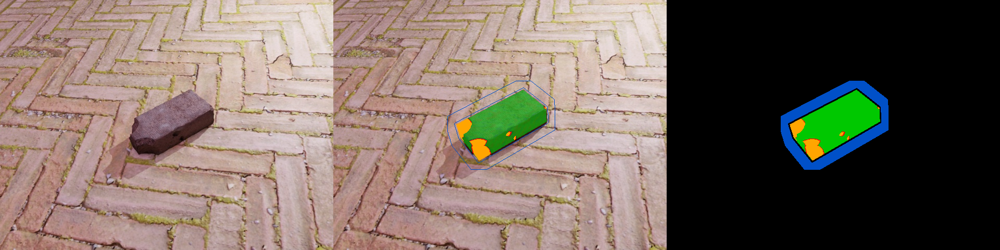
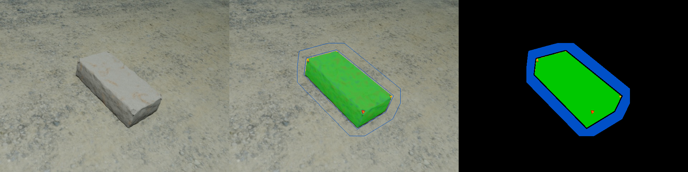
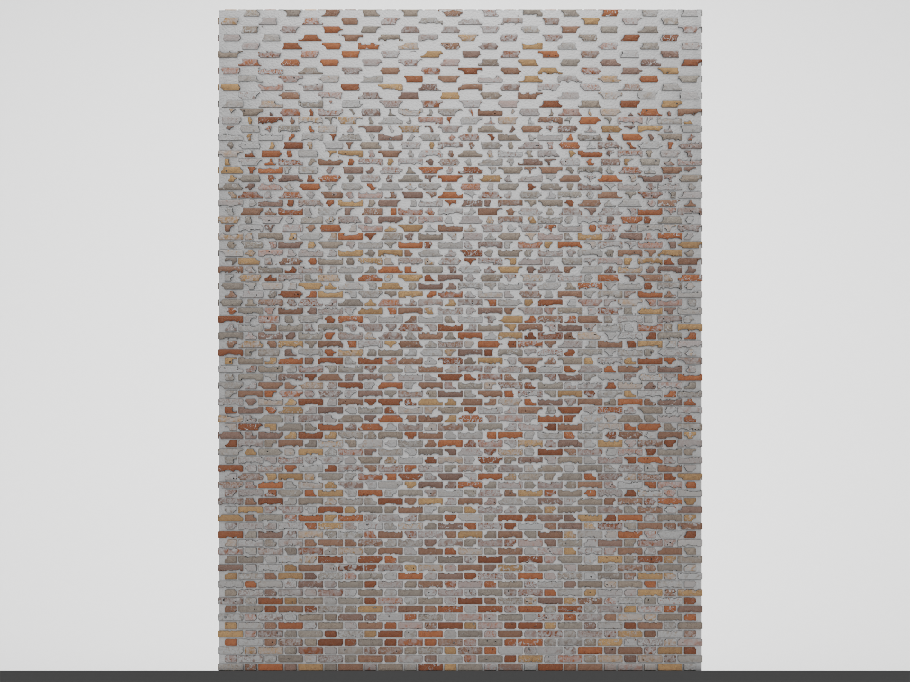
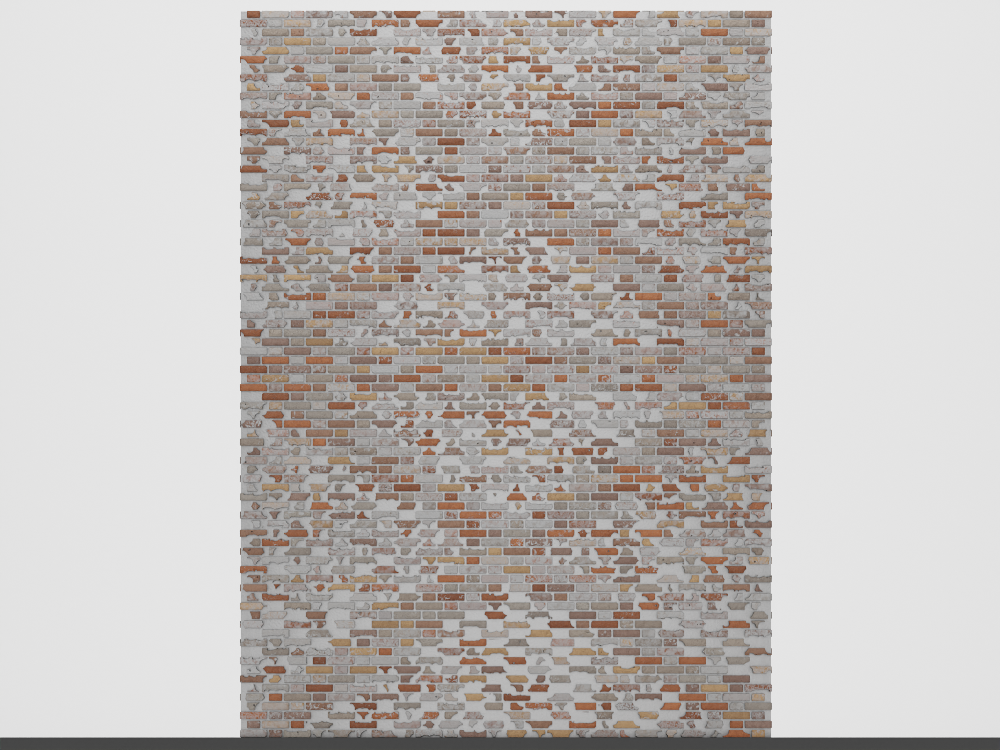

# 🧱 Synthetic Reclaimed Bricks for Training Data and Simulated Allocation 

Code and partial data for the paper *"Robotic Reuse of Brickwork enabled by Spatial AI"*.

This repository generates synthetic reclaimed bricks with procedural material loss (broken corners, surface damage) and uses them for two purposes:

- **Training data**: photorealistic, annotated renders for training brick detection, pose estimation and damage segmentation models.
- **Simulated visualisation**: allocating the synthetic bricks to a container structure following a design logic, then rendering the resulting wall as a visual aid for designers.

Built with [BlenderProc](https://github.com/DLR-RM/BlenderProc), [bpy](https://pypi.org/project/bpy/) and [assembly_information_model](https://github.com/augmentedfabricationlab/assembly_information_model).

Both pipelines start from the same **brick stock**: a set of individually damaged brick meshes saved as OBJ files, plus an intact reference brick.

```
                         ┌─► A. Training data:  render views ─► damage masks
generate brick stock ────┤
   (OBJ files)           └─► B. Simulated visualisation:  grade ─► allocate ─► render wall
```

**A. Training data**: photorealistic, annotated images for training brick detection, pose estimation and damage segmentation models.

| Step | Script |
|---|---|
| Generate brick stock | `code/brick_stock_pipeline/generate_brick_stock.py` |
| Render views of each brick (BOP format, COCO annotations) | `code/brick_stock_pipeline/dataset_from_brick_stock.py` |
| Label per-pixel damage masks for the segmentation head | `code/brick_stock_pipeline/label_damage_masks.py` |

*Sample Outputs*: Rendered views with their damage masks (RGB | damage overlay | class labels).




**B. Simulated visualisation**: grades the brick stock, allocates bricks into a wall, and renders the result.

| Step | Script |
|---|---|
| Generate brick stock | `code/brick_stock_pipeline/generate_brick_stock.py` |
| Grade each brick's damage against the intact reference | `code/allocation_rendering_pipeline/grade_brick_stock.py` |
| Design and allocate the target structure | `rhino/masonry_allocation.ghx` or `code/allocation_rendering_pipeline/design_allocate_target_structure.py` |
| Render the allocated structure (PNG or `.blend`) | `code/allocation_rendering_pipeline/render_allocated_wall.py` |

*Sample Outputs*: Allocated walls rendered with two facade design logics.

| Gradient | Bracing |
|---|---|
|  |  |

---

## Directory Structure

```
synthetic_data_generation/
├── code/
│   ├── brick_stock_pipeline/
│   │   ├── generate_brick_stock.py        # damaged brick OBJs (both pipelines)
│   │   ├── brick_common.py                # shared mesh / damage / material functions
│   │   ├── dataset_from_brick_stock.py    # A: render training views
│   │   └── label_damage_masks.py          # A: per-pixel damage masks
│   ├── allocation_rendering_pipeline/
│   │   ├── damage_grader.py                        # damage grading against the intact brick (also used by A)
│   │   ├── grade_brick_stock.py                    # B: grade stock → material stock JSON
│   │   ├── design_allocate_target_structure.py     # B: build, label and allocate the wall
│   │   ├── preview_allocation.py                   # B: labeled vs allocated front view
│   │   └── render_allocated_wall.py                # B: render allocated wall
│   ├── masonry_allocation/                # B: wall building, labeling, allocation, CellularizedPart
│   ├── custom_writer.py                   # BOP / COCO writer used for training renders
│   └── load_cctextures.py                 # download CC textures into resources/ccmaterials/
├── rhino/
│   └── masonry_allocation.ghx             # B: Grasshopper alternative to design_allocate_target_structure.py
├── resources/
│   ├── brick_material_v2.blend            # brick material
│   ├── mortar_material.blend              # mortar material (wall render)
│   └── ccmaterials/                       # CC textures (downloaded with load_cctextures.py)
└── data/                                  # outputs (only a small sample is included, see below)
    ├── brick_stock/                       # manifest.json, intact_brick.obj, brick_NNNNN.obj
    ├── dataset_from_brick_stock/          # training renders, damage masks, mask previews
    ├── allocation_data/                   # material stock, allocated wall JSON, allocation preview
    └── renders/                           # rendered walls
```

> [!NOTE]
> `data/` only contains a **small sample** for testing the pipelines: 50 bricks in `brick_stock/`, 100 frames in `dataset_from_brick_stock/train_pbr/000000/`, and the material stock graded from those 50 bricks. Generate a larger stock and dataset with the scripts below.

---

## Installation

Download **Blender 3.6.x** (tested with 3.6.12), e.g. to `~/blender/blender-3.6.12-linux-x64`. Then set up everything from one conda environment:

```bash
conda create -n gen_env python=3.11
conda activate gen_env

# packages for gen_env itself (grading, mask labeling)
pip install blenderproc==2.5.0 numpy scipy shapely trimesh rtree opencv-python-headless matplotlib compas

# assembly_information_model (default branch; clone it next to this repo)
git clone https://github.com/augmentedfabricationlab/assembly_information_model.git ../assembly_information_model
pip install -e ../assembly_information_model

# packages for Blender's Python (used by `blenderproc run`)
blenderproc pip install compas shapely ../assembly_information_model --custom-blender-path ~/blender/blender-3.6.12-linux-x64
```

---

## Usage

### Load CC textures into resources

Downloads the [ambientCG](https://ambientcg.com/) textures listed in `ASSETS_TO_DOWNLOAD` into `resources/ccmaterials/`. They are applied randomly to the room around the brick in the training renders. Extend the list to add more.

```bash
blenderproc run code/load_cctextures.py --custom-blender-path ~/blender/blender-3.6.12-linux-x64
```

### Generate brick stock

```bash
blenderproc run code/brick_stock_pipeline/generate_brick_stock.py --num-bricks 1000 --custom-blender-path ~/blender/blender-3.6.12-linux-x64
```

**Output:** `data/brick_stock/`: `manifest.json`, `intact_brick.obj`, `brick_NNNNN.obj`.

### Render views of each brick (BOP format, COCO annotations)

Renders one stock brick per run, so loop over the stock. Needs CC textures in `resources/ccmaterials/`. Produces data for training detection and pose estimation models.

```bash
for i in $(seq 0 999); do
  blenderproc run code/brick_stock_pipeline/dataset_from_brick_stock.py --brick-index $i --num-views 10 --custom-blender-path ~/blender/blender-3.6.12-linux-x64
done
```

**Output:** `data/dataset_from_brick_stock/` (BOP format, COCO annotations).

### Label per-pixel damage masks for the segmentation head

```bash
python code/brick_stock_pipeline/label_damage_masks.py --visualize-one train_pbr/000000 42 --out-dir data/dataset_from_brick_stock/damage_mask_preview  # preview one frame
python code/brick_stock_pipeline/label_damage_masks.py --all                                                                                          # label everything
```

**Output:** `damage_mask/NNNNNN.png` in each chunk folder. Classes: 0 intact, 1 surface damage, 2 missing material, 3 unobserved, 4 environment. The preview writes one image (RGB | damage overlay | class labels) to `data/dataset_from_brick_stock/damage_mask_preview/` and doesn't change the dataset.

> [!NOTE]
> **This is the end of training data generation.**
> The steps below are for the **Simulated visualisation** pipeline.

### Grade each brick's damage against the intact reference

Creates a cell-based representation of every synthetic brick, i.e. the digital material stock used for allocation.

```bash
python code/allocation_rendering_pipeline/grade_brick_stock.py --stock-dir data/brick_stock --out data/allocation_data/material_stock_simulated.json --workers 8
```

**Output:** the material stock JSON at `--out`.

### Design and allocate the target structure

Builds the container structure, labels its facade with a design logic, and allocates stock bricks to it.

**Option 1 (Rhino/Grasshopper):** open `rhino/masonry_allocation.ghx` to design, allocate and preview the structure interactively. For this:

- Add `assembly_information_model/src` and `synthetic_data_generation/code` to Python's module search paths. In the Grasshopper Script Editor, go to *Tools → Options → Python 3 → Module Search Paths*. 
- Install `compas`, `shapely` and `scipy` into Rhino's Python environment (`.rhinocode`). 

**Option 2 (Python):** edit the wall (`build_wall`), label (`label_facade`) and stock filename in the script, then run:

```bash
python code/allocation_rendering_pipeline/design_allocate_target_structure.py
```

**Output:** `data/allocation_data/allocated_assembly.json`, plus `allocation_preview.png`: the labeled container next to the allocated wall's front cells (`preview_allocation.py`).

### Render the allocated wall

Places each brick's damaged OBJ at its allocated position and saves the Blender scene (wall, mortar, backdrop, light, one camera).

```bash
blenderproc run code/allocation_rendering_pipeline/render_allocated_wall.py --allocated-wall data/allocation_data/allocated_assembly.json --stock-dir data/brick_stock --mortar --custom-blender-path ~/blender/blender-3.6.12-linux-x64 --save-blend data/renders/my_wall.blend
```

**Output:** `data/renders/my_wall.blend`. Open it in Blender, move the camera to your view (`Ctrl+Alt+Numpad 0`) and render with `F12`.

